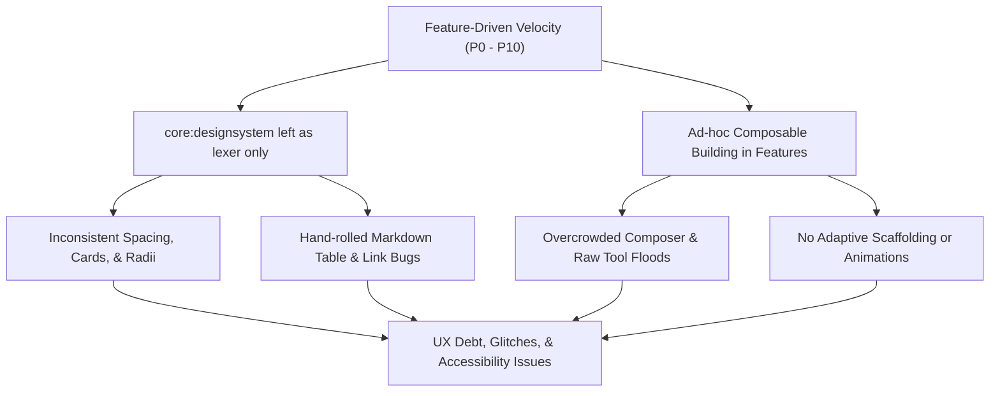
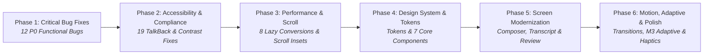

# OpenCode Android — Unified UI & UX Modernization Plan

> **Scope:** Full codebase audit and phased modernization roadmap across 16 Gradle modules, 168 screenshot baselines, and 20+ screens.
> **Finding:** The backend contracts, API coverage (138/138 operations), event plumbing (94/94 events), and state stores are thoroughly wired, but the client UI exhibits significant UX debt, functional bugs, TalkBack silencing, missing lazy collections, and an empty design system.

---

## Executive Summary & Current State

### Architectural Diagnosis
1. **Empty Design System**: [core/designsystem](file:///home/nick/Documents/Projects/opencode-android/core/designsystem) currently serves as a syntax highlighter and markdown lexer rather than a design system. It lacks standard UI primitives (no shared Cards, Buttons, TopBars, Avatars, Badges, or Empty States), forcing feature modules to assemble ad-hoc UI components independently.
2. **Uncontained Transcript & Clutter**: Chat messages lack bubble hierarchy and clear role separation. Tool executions flood the timeline with up to 20 lines of unformatted output per card without folding or summarization.
3. **Overcrowded Composer**: The composer bar stacks up to 12 rows/action groups (banners, text field, autocomplete, chip rows, a 7-button `FlowRow`, and send button), taking up nearly 50% of vertical height before the keyboard opens.
4. **Concrete UI & Functional Bugs**: Multiple severe bugs exist in production paths: timer math subtracting `at - at` resulting in `0ms`, zero-width chips, markdown tables where headers scroll but body rows stay fixed, inert hyperlinks without click handlers, and 1-second polling loops.
5. **Systemic TalkBack Silencing**: Pervasive use of `contentDescription = ""`, `clearAndSetSemantics { }`, and `mergeDescendants = true` hides buttons, switches, and form fields from screen readers.
6. **Absence of Motion, Adaptive Scaffolding & Insets**: The app has no navigation transitions, lacks item placement animations (`animateItem`), omits `imePadding()` on multiple text screens, and does not leverage the declared `androidx.compose.material3.adaptive` dependencies.

### Strengths & Solid Foundation
- **Distinct Visual Identity**: Warm Peach/Blue/Violet palette against Ink/Paper neutrals.
- **Strict Contracts**: 168 screenshot baselines, 138 wired API operations, zero hardcoded colors in feature modules.
- **Clean Architecture**: `Surface`/`Commands`/`Store` patterns with strict unidirectional data flow and clean module boundaries.

---

## Root Cause Analysis



---

## Phased Execution Roadmap

The modernization is structured into **6 sequential phases**. Each phase builds upon the previous one to ensure stability, prevent regressions, and enforce architectural consistency:



---

## Phase 1: Critical Functional Bug Fixes (P0)

> **Objective:** Eliminate broken feature flows, crash-path issues, and data rendering defects where the intent is clear but implementation is incorrect.

| # | Bug | Location | Root Cause | Fix |
|---|-----|----------|------------|-----|
| 1.1 | **Retry countdown always shows "0ms"** | [TimelineList.kt:L416](file:///home/nick/Documents/Projects/opencode-android/feature/sessions/src/main/kotlin/dev/opencode/android/feature/sessions/ui/timeline/TimelineList.kt#L416) | `retry.at - retry.at` (subtracts from itself) | Change calculation to `retry.at - now` |
| 1.2 | **Answer chips crushed to 0px** | [ToolCardView.kt:L278](file:///home/nick/Documents/Projects/opencode-android/feature/sessions/src/main/kotlin/dev/opencode/android/feature/sessions/ui/timeline/ToolCardView.kt#L278) | `Modifier.width(0.dp)` without `weight` | Remove `.width(0.dp)` or apply `.weight(1f, fill = false)` |
| 1.3 | **Rename dialog never appears** | [SessionActions.kt:L122](file:///home/nick/Documents/Projects/opencode-android/feature/sessions/src/main/kotlin/dev/opencode/android/feature/sessions/ui/SessionActions.kt#L122) | Sheet calls `onDismiss()` before `RenameDialog` renders | Lift rename dialog state to parent host composable |
| 1.4 | **Reasoning blocks snap shut during streaming** | [TimelineList.kt:L436](file:///home/nick/Documents/Projects/opencode-android/feature/sessions/src/main/kotlin/dev/opencode/android/feature/sessions/ui/timeline/TimelineList.kt#L436) | `remember` keyed on `part.text.length` resets state on every token | Key remember state on `part.id()` or stable step ID |
| 1.5 | **Follow mode never releases on scroll** | [SessionScreen.kt:L109](file:///home/nick/Documents/Projects/opencode-android/feature/sessions/src/main/kotlin/dev/opencode/android/feature/sessions/ui/SessionScreen.kt#L109) | `onFollowChange(false)` never triggered on upward scroll | Observe scroll delta/offset; disable follow on upward scroll |
| 1.6 | **Infinite pagination loop** | [SessionListScreen.kt:L81](file:///home/nick/Documents/Projects/opencode-android/feature/sessions/src/main/kotlin/dev/opencode/android/feature/sessions/ui/SessionListScreen.kt#L81) | Condition `lastIndex >= size - 3` evaluates `-1 >= -3` as true | Check `listState.layoutInfo.visibleItemsInfo.lastOrNull()?.index` |
| 1.7 | **Forced re-navigation on configuration change** | [MainActivity.kt:L72](file:///home/nick/Documents/Projects/opencode-android/app/src/main/kotlin/dev/opencode/android/MainActivity.kt#L72) | `openSession`/`openLocation` intents not cleared after handling | Guard navigation or clear pending intent payloads post-navigation |
| 1.8 | **Terminal pinch-to-zoom broken** | [index.html:L121](file:///home/nick/Documents/Projects/opencode-android/feature/execution/src/main/assets/terminal/index.html#L121) | `touchend` event checks `event.touches.length !== 2`, always true | Track distance in `touchmove` or check `changedTouches` |
| 1.9 | **Multi-line code swallowed as comments** | [MarkdownText.kt:L247](file:///home/nick/Documents/Projects/opencode-android/core/designsystem/src/main/kotlin/dev/opencode/android/core/designsystem/markdown/MarkdownText.kt#L247) | Single-line lexer applied to multi-line string | Invoke `CodeHighlighter.highlightAll()` instead of `highlighted()` |
| 1.10 | **Session state polled every 1 second** | [SessionViewModels.kt:L326](file:///home/nick/Documents/Projects/opencode-android/feature/sessions/src/main/kotlin/dev/opencode/android/feature/sessions/ui/SessionViewModels.kt#L326) | `combine(..., ticks)` samples `.value` periodically on a loop | Replace ticker loop with reactive `flatMapLatest` on state flows |
| 1.11 | **Draft persistence redundant writes** | [ComposerViewModel.kt:L1419](file:///home/nick/Documents/Projects/opencode-android/feature/composer/src/main/kotlin/dev/opencode/android/feature/composer/ui/ComposerViewModel.kt#L1419) | Spawns un-cancelled coroutine on every keystroke | Maintain `draftJob: Job?` and cancel prior job before scheduling debounce |
| 1.12 | **Save confirmation never shown** | [ReviewViewModel.kt:L302](file:///home/nick/Documents/Projects/opencode-android/feature/review/src/main/kotlin/dev/opencode/android/feature/review/ReviewViewModel.kt#L302) | `writeNotice` set to `null` on successful write | Introduce `WriteOutcome.Success` and render confirmation badge |

---

## Phase 2: Accessibility & Interaction Compliance

> **Objective:** Remediate TalkBack silencing, ensure 48dp touch targets, fix contrast failures, and wire interactive markdown links.

### 2.1 Remediate TalkBack Silencing (P0)
- **Cancel Button**: Remove `clearAndSetSemantics { }` in [FormFields.kt:L381](file:///home/nick/Documents/Projects/opencode-android/feature/requests/src/main/kotlin/dev/opencode/android/feature/requests/ui/FormFields.kt#L381).
- **Attention Channel Rows**: Replace `contentDescription = ""` with localized channel names in [AttentionSettingsSheet.kt:L204](file:///home/nick/Documents/Projects/opencode-android/feature/requests/src/main/kotlin/dev/opencode/android/feature/requests/ui/AttentionSettingsSheet.kt#L204).
- **Switch Toggles**: Remove `clearAndSetSemantics { }` in [AttentionSettingsSheet.kt:L329](file:///home/nick/Documents/Projects/opencode-android/feature/requests/src/main/kotlin/dev/opencode/android/feature/requests/ui/AttentionSettingsSheet.kt#L329).
- **Overflow Menus**: Remove `mergeDescendants = true` hiding `IconButton` in [ServersScreen.kt:L234](file:///home/nick/Documents/Projects/opencode-android/feature/servers/src/main/kotlin/dev/opencode/android/feature/servers/ui/ServersScreen.kt#L234).
- **Attachment Remove Buttons**: Remove `mergeDescendants = true` in [ComposerParts.kt:L187](file:///home/nick/Documents/Projects/opencode-android/feature/composer/src/main/kotlin/dev/opencode/android/feature/composer/ui/ComposerParts.kt#L187).
- **Skill Activation Buttons**: Remove `mergeDescendants = true` hiding `TextButton` in [ComposerSheets.kt:L178](file:///home/nick/Documents/Projects/opencode-android/feature/composer/src/main/kotlin/dev/opencode/android/feature/composer/ui/ComposerSheets.kt#L178).
- **Insights Range Picker**: Remove `mergeDescendants = true` in [InsightsScreen.kt:L122](file:///home/nick/Documents/Projects/opencode-android/feature/insights/src/main/kotlin/dev/opencode/android/feature/insights/InsightsScreen.kt#L122).
- **Dismiss & Remove Buttons**: Restore proper accessibility labels in [ConfigEditorScreen.kt:L303](file:///home/nick/Documents/Projects/opencode-android/feature/admin/src/main/kotlin/dev/opencode/android/feature/admin/ConfigEditorScreen.kt#L303) and [PermissionsScreen.kt:L316](file:///home/nick/Documents/Projects/opencode-android/feature/admin/src/main/kotlin/dev/opencode/android/feature/admin/PermissionsScreen.kt#L316).
- **Execution Back Button**: Supply localized label instead of `null` in [ExecutionHost.kt:L265](file:///home/nick/Documents/Projects/opencode-android/app/src/main/kotlin/dev/opencode/android/navigation/ExecutionHost.kt#L265).

### 2.2 Roles, Touch Targets & Contrast (P1)
- **Roles**: Assign `Role.RadioButton` to `OptionRow` ([FormFields.kt:L364](file:///home/nick/Documents/Projects/opencode-android/feature/requests/src/main/kotlin/dev/opencode/android/feature/requests/ui/FormFields.kt#L364)) and `Role.Checkbox` to `ConsentRow` ([FormFields.kt:L396](file:///home/nick/Documents/Projects/opencode-android/feature/requests/src/main/kotlin/dev/opencode/android/feature/requests/ui/FormFields.kt#L396)).
- **Double Announcements**: Clean up redundant `", selected"` text in [SessionTabStrip.kt:L106](file:///home/nick/Documents/Projects/opencode-android/feature/sessions/src/main/kotlin/dev/opencode/android/feature/sessions/ui/SessionTabStrip.kt#L106) and [SessionListPane.kt:L134](file:///home/nick/Documents/Projects/opencode-android/feature/sessions/src/main/kotlin/dev/opencode/android/feature/sessions/ui/SessionListPane.kt#L134).
- **Touch Targets (48dp Minimum)**:
  - Increase terminal key target size from 38dp to 48dp in [TerminalScreen.kt:L525](file:///home/nick/Documents/Projects/opencode-android/feature/execution/src/main/kotlin/dev/opencode/android/feature/execution/TerminalScreen.kt#L525).
  - Add `Modifier.defaultMinSize(minHeight = 48.dp)` to [ChangedFilesRow.kt:L45](file:///home/nick/Documents/Projects/opencode-android/feature/sessions/src/main/kotlin/dev/opencode/android/feature/sessions/ui/timeline/ChangedFilesRow.kt#L45).
- **Markdown Links**:
  - Replace hardcoded blue with `MaterialTheme.colorScheme.primary` for WCAG AA compliance ([MarkdownText.kt:L284](file:///home/nick/Documents/Projects/opencode-android/core/designsystem/src/main/kotlin/dev/opencode/android/core/designsystem/markdown/MarkdownText.kt#L284)).
  - Attach `LinkAnnotation.Url` and `LocalUriHandler.current` to make hyperlinks clickable and open system browser ([MarkdownText.kt:L283](file:///home/nick/Documents/Projects/opencode-android/core/designsystem/src/main/kotlin/dev/opencode/android/core/designsystem/markdown/MarkdownText.kt#L283)).

---

## Phase 3: Performance & Scroll Infrastructure

> **Objective:** Prevent UI thread freezing and OOMs by converting unbounded linear layouts to `LazyColumn`, adding missing scroll modifiers, and moving heavy computation off the main thread.

### 3.1 Non-Lazy to Lazy Conversions (P0)
Convert the following `Column` + `.forEach` implementations to `LazyColumn`:
1. `DiffTable` (unified diff, 1,000+ lines) — [DiffTable.kt:L149](file:///home/nick/Documents/Projects/opencode-android/core/designsystem/src/main/kotlin/dev/opencode/android/core/designsystem/diff/DiffTable.kt#L149)
2. `SplitDiffTable` (side-by-side diff) — [DiffTable.kt:L346](file:///home/nick/Documents/Projects/opencode-android/core/designsystem/src/main/kotlin/dev/opencode/android/core/designsystem/diff/DiffTable.kt#L346)
3. `ModelPickerSheet` (100–300 models) — [ModelPickerSheet.kt:L91](file:///home/nick/Documents/Projects/opencode-android/feature/composer/src/main/kotlin/dev/opencode/android/feature/composer/ui/ModelPickerSheet.kt#L91)
4. `DirectoryBrowser` (300+ files) — [NewSessionSheet.kt:L448](file:///home/nick/Documents/Projects/opencode-android/feature/composer/src/main/kotlin/dev/opencode/android/feature/composer/ui/NewSessionSheet.kt#L448)
5. `McpResourceSheet` — [McpScreen.kt:L435](file:///home/nick/Documents/Projects/opencode-android/feature/integrations/src/main/kotlin/dev/opencode/android/feature/integrations/McpScreen.kt#L435)
6. `InboxPanel` — [InboxPanel.kt:L65](file:///home/nick/Documents/Projects/opencode-android/feature/composer/src/main/kotlin/dev/opencode/android/feature/composer/ui/InboxPanel.kt#L65)
7. Search Results — [FileBrowserScreen.kt:L205](file:///home/nick/Documents/Projects/opencode-android/feature/review/src/main/kotlin/dev/opencode/android/feature/review/FileBrowserScreen.kt#L205)
8. History Search Hits — [HistoryPanel.kt:L121](file:///home/nick/Documents/Projects/opencode-android/feature/review/src/main/kotlin/dev/opencode/android/feature/review/HistoryPanel.kt#L121)

### 3.2 Scroll Enclosure & Table Fixes (P0)
- **Unified Markdown Table Scrolling**: Wrap entire table (header + data rows) in a single horizontal scroll container ([MarkdownText.kt:L170-L192](file:///home/nick/Documents/Projects/opencode-android/core/designsystem/src/main/kotlin/dev/opencode/android/core/designsystem/markdown/MarkdownText.kt#L170-L192)) to prevent header/row desynchronization.
- **Missing Scrolls**:
  - Add `.verticalScroll()` to Shell Output ([ShellsScreen.kt:L327](file:///home/nick/Documents/Projects/opencode-android/feature/execution/src/main/kotlin/dev/opencode/android/feature/execution/ShellsScreen.kt#L327)).
  - Add `.verticalScroll()` to Session Terminals Pane ([SessionTerminalsPane.kt:L246](file:///home/nick/Documents/Projects/opencode-android/feature/execution/src/main/kotlin/dev/opencode/android/feature/execution/SessionTerminalsPane.kt#L246)).
  - Add `.horizontalScroll()` to Code Viewer ([FileBrowserScreen.kt:L443](file:///home/nick/Documents/Projects/opencode-android/feature/review/src/main/kotlin/dev/opencode/android/feature/review/FileBrowserScreen.kt#L443)).

### 3.3 Main-Thread Offloading (P1)
- Pre-compute diff syntax tokens on `Dispatchers.Default` ([DiffTable.kt:L191](file:///home/nick/Documents/Projects/opencode-android/core/designsystem/src/main/kotlin/dev/opencode/android/core/designsystem/diff/DiffTable.kt#L191)).
- Highlight file browser code via `produceState` on background dispatcher ([FileBrowserScreen.kt:L427](file:///home/nick/Documents/Projects/opencode-android/feature/review/src/main/kotlin/dev/opencode/android/feature/review/FileBrowserScreen.kt#L427)).
- Decode images using `Dispatchers.Default` ([FileBrowserScreen.kt:L511](file:///home/nick/Documents/Projects/opencode-android/feature/review/src/main/kotlin/dev/opencode/android/feature/review/FileBrowserScreen.kt#L511)).
- Wrap sorting during recomposition in `remember()` ([InsightsScreen.kt:L291](file:///home/nick/Documents/Projects/opencode-android/feature/insights/src/main/kotlin/dev/opencode/android/feature/insights/InsightsScreen.kt#L291)).
- Replace O(n²) allocations in log replay with `MutableList` batch updates ([SessionLogViewModel.kt:L72](file:///home/nick/Documents/Projects/opencode-android/feature/sessions/src/main/kotlin/dev/opencode/android/feature/sessions/ui/SessionLogViewModel.kt#L72)).

---

## Phase 4: Design System Foundation (`:core:designsystem`)

> **Objective:** Transform `:core:designsystem` from a syntax lexer into a complete UI design system with expressive tokens and shared components.

### 4.1 Design Tokens
- **Typography Scale**: Replace empty `Typography()` in [Type.kt](file:///home/nick/Documents/Projects/opencode-android/core/designsystem/src/main/kotlin/dev/opencode/android/core/designsystem/theme/Type.kt#L31) with tailored weights, line heights, and letter-spacing for headlines, titles, body, and mono styles.
- **Spacing Tokens**: Introduce `OpenCodeSpacing` (`xs = 4.dp`, `sm = 8.dp`, `md = 12.dp`, `lg = 16.dp`, `xl = 24.dp`, `xxl = 32.dp`).
- **Shape Tokens**: Introduce `OpenCodeShapes` (`small = 8.dp`, `medium = 12.dp`, `large = 16.dp`, `full = 999.dp`).
- **Semantic Colors**: Expose `OpenCodeColors` via `CompositionLocal` with `success`, `warning`, `info`, `diffAdded`, and `diffRemoved` (meeting WCAG 2.1 AA across light/dark modes).
- **Branding Preservation**: Disable `dynamicColor = true` by default on Android 12+ to retain the intended brand palette.

### 4.2 Reusable Core Components
Build and export standard components in `:core:designsystem`:
1. `OpenCodeCard`: Consistent container with subtle `outlineVariant` border, uniform corner radius, and container colors.
2. `OpenCodeScaffold` / `OpenCodeTopAppBar`: Unified top bar replacing divergent implementations (`AdminScaffold`, `IntegrationsScaffold`, `ExecutionTopBar`).
3. `OpenCodeButton`: Standardized Primary, Outlined, and Destructive buttons with integrated loading spinner.
4. `OpenCodeEmptyState`: Centered graphic/icon illustration, title, subtitle, and primary call-to-action button.
5. `OpenCodeBadge` / `OpenCodeChip`: Pill badges for session states (Running, Retrying, Idle, Error) and tags.
6. `OpenCodeAvatar`: Distinct circular avatars with tinted backgrounds for projects, agents, and servers.
7. `OpenCodeCodeBlock`: Enriched code block with header bar, syntax language tag, and a 1-tap **Copy Code** button.

---

## Phase 5: Core Screen Modernization

> **Objective:** Apply the new design system to overhaul the primary user workflows: Composer, Chat Transcript, and Code Review.

### 5.1 Composer Ergonomics (`:feature:composer`)
- **2-Row Compact Layout**:
  - *Context Row*: Above text field, render only contextual chips (active model, agent, and attachment thumbnails).
  - *Input Row*: Expandable `BasicTextField` (1 to 4 lines) with left `+` attachment button and right circular Send/Stop button.
- **Secondary Actions Action Sheet**:
  - Move the 7-icon `FlowRow` (`Attach`, `Skill`, `History Up/Down`, `Stash`, `Pop`, `Editor`) into a single `ModalBottomSheet` opened via the `+` button.
  - Reclaims ~75% of composer vertical height for conversation history.
- **IME & Keyboard Inset Coordination**:
  - Apply proper `.imePadding()` and `.windowInsetsPadding(WindowInsets.navigationBars)` so input smoothly tracks keyboard transitions.
  - Apply `.imePadding()` to `ConfigEditorScreen`, `QuickAskScreen`, `FullScreenEditor`, and `CommandPaletteDialog`.
- **Composer Wiring Fixes**:
  - Render missing `ReviewCommentChips(...)` above attachments ([ComposerBar.kt:L177](file:///home/nick/Documents/Projects/opencode-android/feature/composer/src/main/kotlin/dev/opencode/android/feature/composer/ui/ComposerBar.kt#L177)).
  - Change misleading "Send" button in FullScreenEditor to "Done" / "Apply" ([FullScreenEditor.kt:L68](file:///home/nick/Documents/Projects/opencode-android/feature/composer/src/main/kotlin/dev/opencode/android/feature/composer/ui/FullScreenEditor.kt#L68)).
  - Disable autocorrect and enable monospace in Shell mode ([ComposerBar.kt:L158](file:///home/nick/Documents/Projects/opencode-android/feature/composer/src/main/kotlin/dev/opencode/android/feature/composer/ui/ComposerBar.kt#L158)).

### 5.2 Chat Transcript & Tool Orchestration (`:feature:sessions`)
- **Message Containers**:
  - *User Message*: Right-aligned container with subtle surface tint, rounded pill shape, and clear attachment cards.
  - *Assistant Message*: Padded container with agent avatar, model pill, and metadata.
- **Collapsible Tool Group Accordion**:
  - Group sequential tool executions into a single expandable accordion row: *"Ran 3 tools: read_file, edit_file (1.4s)"*.
  - Show top 3 lines of output with a "Show all" expansion rather than dumping 20 unscrollable lines per tool.
- **Home & Session List Cleanups**:
  - Deduplicate running sessions from recent sessions in Home ([HomeScreen.kt:L111](file:///home/nick/Documents/Projects/opencode-android/feature/sessions/src/main/kotlin/dev/opencode/android/feature/sessions/ui/HomeScreen.kt#L111)).
  - Increase progress indicator from 12dp to 18dp ([HomeScreen.kt:L483](file:///home/nick/Documents/Projects/opencode-android/feature/sessions/src/main/kotlin/dev/opencode/android/feature/sessions/ui/HomeScreen.kt#L483)).
  - Add pull-to-refresh (`PullToRefreshBox`) to Home and Session List screens.

### 5.3 Review & Diff Screen (`:feature:review`)
- **Clear Navigation Controls**:
  - Replace ambiguous `< > < >` icon sequence ([ReviewScreen.kt:L164-L176](file:///home/nick/Documents/Projects/opencode-android/feature/review/src/main/kotlin/dev/opencode/android/feature/review/ReviewScreen.kt#L164-L176)) with an explicit File Selector chip (`File 2 of 5: ReviewViewModel.kt ▼`) and labeled hunk navigation (`[ Prev Hunk ] [ Next Hunk ]`).
- **Hunk Navigation Scrolling**:
  - Add `LaunchedEffect` with `animateScrollToItem` when navigating hunks ([ReviewScreen.kt:L485](file:///home/nick/Documents/Projects/opencode-android/feature/review/src/main/kotlin/dev/opencode/android/feature/review/ReviewScreen.kt#L485)).
- **Diff Gutter Polish**:
  - Replace tab (`\t`) alignment in diff gutter with dual fixed-width columns ([DiffTable.kt:L203](file:///home/nick/Documents/Projects/opencode-android/core/designsystem/src/main/kotlin/dev/opencode/android/core/designsystem/diff/DiffTable.kt#L203)).

---

## Phase 6: Motion, Adaptive Layouts & UX Polish

> **Objective:** Add fluid transitions, tactile haptic feedback, responsive multi-window adaptive layouts, and ergonomic keyboard shortcuts.

### 6.1 Adaptive Scaffolding & Responsive Layouts
- **Material 3 Adaptive Scaffolding**:
  - Replace hardcoded `840dp` check with `calculateWindowSizeClass()` and `ListDetailPaneScaffold` / `SupportingPaneScaffold`:
    - *Compact (< 600dp)*: Single pane navigation stack.
    - *Medium (600dp–840dp, foldables/tablets in portrait)*: Navigation rail + content.
    - *Expanded (840dp+)*: Two-pane list-detail layout.
- **Terminal Layout Ergonomics**:
  - Collapse the 40% height terminal list into tabs or an action bar dropdown when an active terminal session is running ([TerminalScreen.kt:L108](file:///home/nick/Documents/Projects/opencode-android/feature/execution/src/main/kotlin/dev/opencode/android/feature/execution/TerminalScreen.kt#L108)).
  - Pass dynamic theme background to xterm WebView via JS bridge rather than hardcoded dark color ([index.html:L20](file:///home/nick/Documents/Projects/opencode-android/feature/execution/src/main/assets/terminal/index.html#L20)).

### 6.2 Motion & Animation
- **Navigation Transitions**:
  - Add Material shared horizontal axis slide and fade animations to `NavHost` in [Routes.kt:L394](file:///home/nick/Documents/Projects/opencode-android/app/src/main/kotlin/dev/opencode/android/navigation/Routes.kt#L394).
  - Wrap `NavHost` in `Surface(color = MaterialTheme.colorScheme.background)` to eliminate white flashes between route transitions.
- **Item Animations**:
  - Add `Modifier.animateItem()` to message lists and cards in `TimelineList` and `HomeScreen`.

### 6.3 Haptic Feedback & Micro-Interactions
- Add `LocalHapticFeedback.current.performHapticFeedback()` across key interaction points:
  - Long-press on Send to queue a prompt.
  - Terminal soft key clicks.
  - High-impact permission decisions (Allow / Reject in `RequestDock`).
  - Destructive actions (Delete session, Evict cache, Revoke credential).
  - Copy code block feedback.
  - QR code detection in scanner.
- **Keyboard Shortcuts**:
  - Add hardware arrow navigation (Up/Down/Enter) to `CommandPaletteDialog` ([CommandPaletteDialog.kt:L86](file:///home/nick/Documents/Projects/opencode-android/app/src/main/kotlin/dev/opencode/android/navigation/CommandPaletteDialog.kt#L86)).
  - Display a subtle HUD indicator when leader key (Ctrl+X) is armed ([LeaderKeys.kt:L47](file:///home/nick/Documents/Projects/opencode-android/app/src/main/kotlin/dev/opencode/android/navigation/LeaderKeys.kt#L47)).

---

## Verification & Testing Gate Strategy

All changes must pass strict repository quality gates:

```bash
# Tier 1: Fast Node Gates (< 2s)
node tools/audit-coverage.mjs --strict
node tools/gen-event-payloads.mjs --check
node tools/audit-viewmodels.test.mjs && node tools/audit-viewmodels.mjs
node tools/audit-strings.mjs
node tools/audit-accessibility.mjs
node tools/audit-matrix.test.mjs && node tools/audit-matrix.mjs

# Tier 2: Gradle Gates
./gradlew unitTest
./gradlew lintDebug
./gradlew spotlessCheck

# Tier 3: Screenshot Baseline Verification & Recording
./gradlew verifyRoborazziDebug
./gradlew recordRoborazziDebug  # when baselines are intentionally updated
```

### Screenshot Test Suite Expansion
- Expand test coverage to `:app`, `:feature:composer`, and `:feature:insights`.
- Add standard mobile device qualifiers (`w360dp-h640dp`, `w411dp-h891dp`) alongside the existing `h2000dp` captures to assert against viewport clipping and IME overlap bugs.

---

## Action Items Summary

| Phase | Focus Area | Actionable Items | Priority |
|:------|:-----------|:-----------------|:---------|
| **Phase 1** | Critical Bug Fixes | 12 functional bug fixes | P0 |
| **Phase 2** | Accessibility & Compliance | 10 TalkBack fixes, 9 role/contrast/target fixes | P0 / P1 |
| **Phase 3** | Performance & Scroll | 8 Lazy conversions, 4 scroll fixes, 5 background dispatches | P0 / P1 |
| **Phase 4** | Design System Foundation | 5 token groups, 7 reusable core components | P1 |
| **Phase 5** | Core Screen Modernization | Composer 2-row layout, Accordions, Review controls, IME insets | P1 / P2 |
| **Phase 6** | Motion, Adaptive & Polish | Adaptive scaffolds, Nav transitions, Haptics, HUDs | P1 / P2 |
| **Total** | | **~100 Actionable Items** | |
