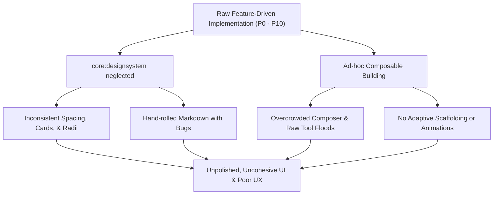
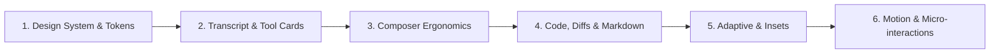
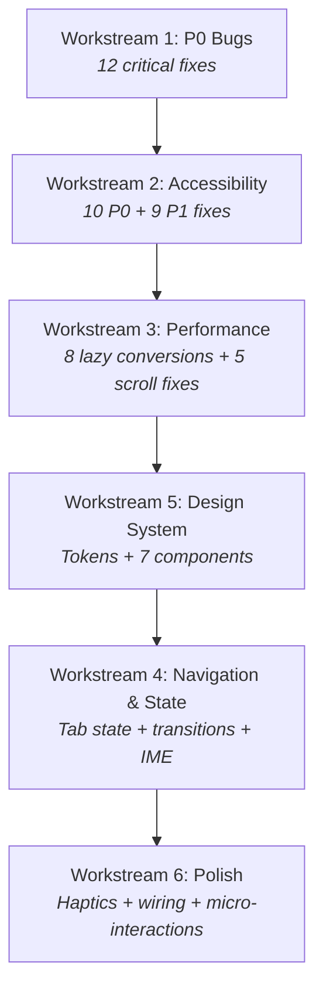

# Comprehensive UI & UX Survey & Modernization Roadmap

## Executive Summary

A deep, read-only architectural and visual survey of the OpenCode Android codebase was conducted across all 16 modules, the Roborazzi screenshot baselines (168 captures), the manual test matrices, and the core design system.

**The Diagnosis**: While the backend contracts, API coverage (138/138 operations), event plumbing (94/94 events), and state stores are thoroughly wired, **the user interface resembles a raw developer prototype rather than a polished, native Android application**. 

The root causes of this UX debt are:
1. **Empty Design System**: [core/designsystem](file:///home/nick/Documents/Projects/opencode-android/core/designsystem) provides zero shared UI components (no standardized Card, Button, TopBar, Tag, Avatar, or Badge). Every feature module had to cobble together its own ad-hoc UI primitives.
2. **Uncontained Transcript & Visual Clutter**: The chat transcript lacks cohesive message containers, role distinction, and collapsible tool groups. Raw text floats in dark voids, and tool calls flood the viewport with up to 20 lines of unformatted output each.
3. **Overcrowded Composer**: The composer bar tries to display 4 rows of controls (revert banners, text field, autocomplete, context info, horizontal chip row, 7-button icon flow, and send button) taking up nearly 50% of vertical height before the keyboard even opens.
4. **Concrete UI Bugs**: The hand-rolled Markdown table renderer desynchronizes headers from rows during horizontal scroll; Markdown links are inert non-clickable text with hardcoded colors; chevrons are duplicated without labels (`< > < >`); and empty/fallback states trap users without app bars.
5. **Absence of Motion, Polish & Insets**: The app has virtually zero Compose transitions (`AnimatedVisibility`, `animateItem`, `AnimatedContent`), no haptic feedback, and does not use Android's Material 3 Adaptive layout libraries despite including them in `libs.versions.toml`.

---

## 1. Deep Survey of UI/UX Issues & Bugs

### A. Design System & Visual Foundation

* **Stock Material 3 Typography**:
  * In [Type.kt](file:///home/nick/Documents/Projects/opencode-android/core/designsystem/src/main/kotlin/dev/opencode/android/core/designsystem/theme/Type.kt#L31), typography is declared simply as `internal val OpenCodeTypography: Typography = Typography()`. There is no tailored type scale, line heights, or weights. Standard roboto/system font is juxtaposed abruptly with JetBrains Mono.
* **Palette & Contrast Failures**:
  * In [Color.kt](file:///home/nick/Documents/Projects/opencode-android/core/designsystem/src/main/kotlin/dev/opencode/android/core/designsystem/theme/Color.kt#L46-L114), `OpenCodeDarkColors` and `OpenCodeLightColors` use near-black (`#0A0A0A`) and near-white (`#FAFAFA`) surfaces with stark `Peach` and `Blue` accents.
  * Per `docs/MANUAL_TEST_MATRIX.md` (item K6), **46 color pairs fail WCAG 2.1 AA contrast** (< 4.5:1), including `onSecondary`/`secondary` (4.11), `secondary`/`surface` (3.94), code comments (3.59), and diff gutter line numbers (2.77 - 3.04).
* **Card & Surface Inconsistencies**:
  * Corner radii vary randomly across screens: 6dp in [ToolCardView.kt](file:///home/nick/Documents/Projects/opencode-android/feature/sessions/src/main/kotlin/dev/opencode/android/feature/sessions/ui/timeline/ToolCardView.kt#L134), 8dp in [CodeBlock](file:///home/nick/Documents/Projects/opencode-android/core/designsystem/src/main/kotlin/dev/opencode/android/core/designsystem/markdown/MarkdownText.kt#L237), 12dp in [ServersScreen.kt](file:///home/nick/Documents/Projects/opencode-android/feature/servers/src/main/kotlin/dev/opencode/android/feature/servers/ui/ServersScreen.kt#L236), and default M3 curves elsewhere.
  * In `HomeScreen.kt`, unread session cards turn completely solid light-blue (`secondaryContainer`), looking like active selections rather than unread badges.
* **Primitive Placeholders**:
  * In [HomeScreen.kt](file:///home/nick/Documents/Projects/opencode-android/feature/sessions/src/main/kotlin/dev/opencode/android/feature/sessions/ui/HomeScreen.kt#L427-L436), project avatars are literally rendered as raw text `Text(label.take(1).uppercase())` inside an unstyled `Box(28.dp)` with no circular background or surface container.
  * Badges are rendered as plain text strings stacked on new lines ([HomeScreen.kt#L492](file:///home/nick/Documents/Projects/opencode-android/feature/sessions/src/main/kotlin/dev/opencode/android/feature/sessions/ui/HomeScreen.kt#L492)) instead of Material `SuggestionChip`s or `Badge`s.

---

### B. Chat Transcript & Session Screen

* **Asymmetric Message Styling (No Bubble Hierarchy)**:
  * In [TimelineList.kt](file:///home/nick/Documents/Projects/opencode-android/feature/sessions/src/main/kotlin/dev/opencode/android/feature/sessions/ui/timeline/TimelineList.kt#L229-L347), user prompts are rendered inside solid `Card(containerColor = secondaryContainer)` spanning full screen width, whereas assistant messages are rendered as completely uncontained text directly on the screen background.
  * There are no assistant avatars, role indicators, or distinct chat container boundaries.
* **Tool Card Flooding**:
  * When an agent turn executes multiple tools (e.g. `read_file`, `grep`, `edit_file`, `run_command`), each card is expanded by default with up to 20 lines of raw output ([ToolCardView.kt#L172](file:///home/nick/Documents/Projects/opencode-android/feature/sessions/src/main/kotlin/dev/opencode/android/feature/sessions/ui/timeline/ToolCardView.kt#L172)).
  * A 5-tool sequence takes several screen heights of space, burying the actual assistant prose. There is no grouped summary (e.g., *"Ran 4 tools · 1.2s"*).
  * Tool cards have no distinct iconography (e.g. no magnifying glass for search, no terminal icon for shell, no file badge for file ops).
* **Micro-spinner Jitter**:
  * In [HomeScreen.kt](file:///home/nick/Documents/Projects/opencode-android/feature/sessions/src/main/kotlin/dev/opencode/android/feature/sessions/ui/HomeScreen.kt#L483), running sessions display a `CircularProgressIndicator(size = 12.dp, strokeWidth = 2.dp)`. At 12dp, the spinner is tiny, and in static states or frame drops looks like a stray punctuation apostrophe (`'`).
* **Session Metadata Overhead**:
  * Every single assistant step repeats `build fake/text#default 200ms` directly above the text with no visual separation or metadata chip styling.

---

### C. Composer & Input Experience

* **Vertical Overcrowding**:
  * [ComposerBar.kt](file:///home/nick/Documents/Projects/opencode-android/feature/composer/src/main/kotlin/dev/opencode/android/feature/composer/ui/ComposerBar.kt#L144-L318) stacks:
    1. Error row
    2. Problem warning
    3. Revert/undo banner
    4. Outlined text field (up to 6 lines)
    5. Search progress bar
    6. Completion suggestions
    7. Attachment chips
    8. Context summary label ("Sends: nothing yet")
    9. Horizontal chip row (Next agent, Variant, Delivery mode, Resume, Model, Inbox)
    10. Stop & Background action row (when busy)
    11. 7-action `FlowRow` (Attach, Skill, History Up, History Down, Stash, Pop, Fullscreen)
    12. Floating Send button
  * On a typical 360–392dp phone screen, this consumes >300dp of vertical space, leaving less than 20% of the display for the timeline. When the IME (software keyboard) appears, the timeline disappears completely.
* **Keyboard Inset Collisions**:
  * In [Routes.kt](file:///home/nick/Documents/Projects/opencode-android/app/src/main/kotlin/dev/opencode/android/navigation/Routes.kt#L380), the root `Box` has no Scaffold and handles navigation bar padding manually. The composer sits in `bottomBar` without responsive `imePadding()` coordination, causing floating keyboard accessory strips to cover buttons (matrix item F1).
* **Action Row Ergonomics**:
  * Seven icon buttons in a `FlowRow` at the bottom wrap unpredictably on narrower devices (320dp vs 360dp vs 411dp).
  * History navigation uses bare Up/Down arrows (`Icons.Filled.KeyboardArrowUp` / `Down`) which have no label and are easily confused with scrolling.

---

### D. Markdown, Code & Diffs

* **Broken Markdown Table Horizontal Scrolling**:
  * In [MarkdownText.kt](file:///home/nick/Documents/Projects/opencode-android/core/designsystem/src/main/kotlin/dev/opencode/android/core/designsystem/markdown/MarkdownText.kt#L171-L204):
    ```kotlin
    // Line 171: Header is scrollable
    Row(modifier = Modifier.fillMaxWidth().horizontalScroll(scroll)) { ... }
    HorizontalDivider()
    // Line 192: Rows below are NOT scrollable!
    block.rows.forEach { row ->
        Row(modifier = Modifier.fillMaxWidth()) {
            row.forEachIndexed { column, cell -> ... }
        }
    }
    ```
    The table header scrolls horizontally with `rememberScrollState()`, while the data rows underneath are in a fixed, non-scrollable `Row`. Scrolling the header disconnects it from the content and truncates columns!
  * Every column width is hardcoded to `160.dp` regardless of content size.
* **Dead / Inert Links**:
  * In [MarkdownText.kt](file:///home/nick/Documents/Projects/opencode-android/core/designsystem/src/main/kotlin/dev/opencode/android/core/designsystem/markdown/MarkdownText.kt#L283-L286):
    ```kotlin
    is MarkdownInline.Link -> withStyle(
        SpanStyle(color = Color(0xFF1A73E8)),
    ) { append(inline.text) }
    ```
    Markdown links are rendered with a hardcoded blue `SpanStyle` and **no click listener, no URL annotation, and no intent handler**. Clicking any hyperlink in an assistant answer does nothing.
* **Missing Code Block Features**:
  * In [MarkdownText.kt](file:///home/nick/Documents/Projects/opencode-android/core/designsystem/src/main/kotlin/dev/opencode/android/core/designsystem/markdown/MarkdownText.kt#L225-L253), code blocks lack a header bar, syntax language chip, and crucially, a **Copy Code button**.
* **Review Screen Navigation Ambiguity (`< > < >`)**:
  * In [ReviewScreen.kt](file:///home/nick/Documents/Projects/opencode-android/feature/review/src/main/kotlin/dev/opencode/android/feature/review/ReviewScreen.kt#L164-L176), four identical icon buttons (`< > < >`) are placed side-by-side with no labels:
    * Left two: Previous File / Next File
    * Right two: Previous Hunk / Next Hunk
    * On mobile screens without hover tooltips, users have no idea what each button does.

---

### E. Execution & Request Sheets

* **Terminal Screen Space Waste**:
  * In [TerminalScreen.kt](file:///home/nick/Documents/Projects/opencode-android/feature/execution/src/main/kotlin/dev/opencode/android/feature/execution/TerminalScreen.kt#L112), `TerminalList` retains 40% of the screen height even when an active terminal session is open. In landscape or small screens, this constrains the interactive xterm.js terminal to only 8 visible lines (matrix item F4).
* **Cluttered Permission Card**:
  * In [RequestDock.kt](file:///home/nick/Documents/Projects/opencode-android/feature/requests/src/main/kotlin/dev/opencode/android/feature/requests/ui/RequestDock.kt#L225-L230), an `OutlinedTextField` for rejection feedback is permanently rendered on the permission card even when the user simply wants to tap "Allow once".
* **Dead-End State in Insights**:
  * In [InsightsScreen.kt](file:///home/nick/Documents/Projects/opencode-android/feature/insights/src/main/kotlin/dev/opencode/android/feature/insights/InsightsScreen.kt#L69-L74), if `!state.available`, the composable returns a bare `Text` view without a top app bar, title, or back arrow, stranding the user.

---

### F. Adaptive Layouts & System Motion

* **Missing Material 3 Adaptive Layouts**:
  * While `androidx.compose.material3.adaptive` is declared in Gradle dependencies, none of its components (`ListDetailPaneScaffold`, `SupportingPaneScaffold`, `NavigationSuiteScaffold`) are implemented.
  * The only adaptive behavior in the entire project is a hardcoded `LocalConfiguration.current.screenWidthDp >= 840` check in [Routes.kt](file:///home/nick/Documents/Projects/opencode-android/app/src/main/kotlin/dev/opencode/android/navigation/Routes.kt#L560) for `SessionListPane`. Devices between 600dp and 840dp (tablets in portrait, foldables unfolded) receive the cramped phone layout.
* **Absence of Animation and Transitions**:
  * Screen transitions are instant snaps with no navigation slide/crossfade transitions.
  * Chat messages pop into existence without item placement animations (`Modifier.animateItem()`).
  * Sheet and card expansions lack smooth spring physics.

---

## 2. Root Cause Analysis



1. **Architecture Focused on Strict Contracts over Visual Design**: The repository strictly verified API matrices (§7/§8), Room schemas, and command gates, but intentionally left UI components as minimal wrappers around raw M3 primitives.
2. **Missing Component Layer in `core:designsystem`**: Because features cannot depend on each other, and `core:designsystem` contained only Markdown/Syntax lexers, each feature had to independently invent card layouts, headers, and banners.
3. **Desktop TUI Direct Translation**: Many desktop TUI affordances (like showing all tools expanded, keyboard leader keys, stashing, and multi-mode prompts) were mapped 1:1 onto phone screens without mobile UX ergonomics.

---

## 3. Strategic Roadmap to Modernize UI & UX

To make OpenCode Android visually stunning, tactile, and bug-free, work should proceed in six structured phases:



---

### Phase 1: Design System Overhaul & Component Foundations (`:core:designsystem`)

* **Define M3 Expressive Palette & Typography Scale**:
  * Refine [OpenCodePalette](file:///home/nick/Documents/Projects/opencode-android/core/designsystem/src/main/kotlin/dev/opencode/android/core/designsystem/theme/Color.kt#L13) to meet WCAG 2.1 AA contrast across all 144 pairs.
  * Replace the blank `Typography()` in [Type.kt](file:///home/nick/Documents/Projects/opencode-android/core/designsystem/src/main/kotlin/dev/opencode/android/core/designsystem/theme/Type.kt#L31) with a typographic scale (distinct headline, title, body, and mono styles).
  * Introduce standard dimension tokens: `Spacing` (`xs = 4.dp`, `sm = 8.dp`, `md = 12.dp`, `lg = 16.dp`, `xl = 24.dp`) and `Shapes` (`small = 8.dp`, `medium = 12.dp`, `large = 16.dp`, `full = 999.dp`).
* **Build Reusable Core Components in `:core:designsystem`**:
  * `OpenCodeCard`: Standardized card with subtle border outlines (`outlineVariant`), consistent elevation, and rounded corners.
  * `OpenCodeBadge` / `OpenCodeChip`: For session status (Running, Retrying, Unread) and tags.
  * `OpenCodeAvatar`: Distinct circular avatars with tinted initial backgrounds for projects, agents, and servers.
  * `OpenCodeTopAppBar`: Consistent app bar with standard back button affordances and title/subtitle layout.
  * `OpenCodeEmptyState`: Centered graphic/icon illustration, title, subtitle, and primary call-to-action button.

---

### Phase 2: Transcript, Chat Bubbles & Tool Orchestration (`:feature:sessions`)

* **Chat Bubble Redesign**:
  * **User Messages**: Right-aligned or distinct container with subtle surface tint, rounded corners (with an incoming chat tail or rounded pill look), and clear attachment thumbnails.
  * **Assistant Messages**: Left-aligned, cleanly padded container with an Agent Avatar header, model pill (`claude-3-7-sonnet`), and duration badge.
* **Collapsible Tool Call Groups (Accordion View)**:
  * Replace the flood of individual full-width tool cards with an accordion or expandable pill:
    * *Collapsed state*: `"Ran 3 tools: read_file, edit_file, shell (1.4s)"` with status icon (green check / red error).
    * *Expanded state*: Nested, compact tool rows with dedicated icons (file icon, terminal icon, web globe).
  * Collapsed output by default: Show the first 3 lines of output with a clean `"Show more"` expansion instead of 20 unscrollable lines.

---

### Phase 3: Modern, Ergonomic Composer (`:feature:composer`)

* **Clean 2-Row Modern Composer Layout**:
  * **Row 1 (Floating action / context bar)**: Above the text field, show only relevant contextual chips (active model chip, active agent chip, attachment preview chips).
  * **Row 2 (Input & Send)**:
    * Left icon: Attachment `+` button that opens a bottom sheet with all tools (Skills, Attach File, Stash, History, Fullscreen).
    * Center: Auto-expanding `BasicTextField` inside a pill container (1 to 4 lines).
    * Right: Circular Send button with morphing state (Send / Stop when busy).
* **Consolidate Secondary Actions into an Action Sheet**:
  * Move the 7 icon buttons (`Attach`, `Skill`, `History Up`, `History Down`, `Stash`, `Pop`, `Editor`) into a single `ModalBottomSheet` or expand menu triggered by a single `+` action button.
  * This reduces composer height from ~300dp to ~64dp, reclaiming 75% of the screen for conversation history.
* **Full Keyboard Inset Handling**:
  * Apply `.imePadding()` and `.windowInsetsPadding(WindowInsets.navigationBars)` properly so the input cleanly tracks keyboard animations without hiding action buttons.

---

### Phase 4: Code, Diff & Markdown Polish (`:core:designsystem` & `:feature:review`)

* **Fix Markdown Table & Link Bugs**:
  * Fix the table renderer in [MarkdownText.kt](file:///home/nick/Documents/Projects/opencode-android/core/designsystem/src/main/kotlin/dev/opencode/android/core/designsystem/markdown/MarkdownText.kt#L169-L205): Wrap the *entire table* (header + rows) in a single horizontal scroll container. Compute dynamic column widths.
  * Enable links: Use Compose `LinkAnnotation.Url` or `ClickableText` with `LocalUriHandler.current` so tapping links opens the browser.
* **Code Block Enhancement**:
  * Add a top header bar to `CodeBlock` showing language tag on the left and a `"Copy"` button on the right with animated check feedback.
* **Review Screen Navigation Refactor**:
  * Replace the cryptic `< > < >` in [ReviewScreen.kt](file:///home/nick/Documents/Projects/opencode-android/feature/review/src/main/kotlin/dev/opencode/android/feature/review/ReviewScreen.kt#L164-L176) with:
    * A dedicated File selector dropdown/chip: `[ File 2 of 5: ReviewViewModel.kt ▼ ]`
    * Distinct hunk navigation buttons with text: `[ Prev Hunk ]` `[ Next Hunk ]`
* **Diff Presentation**:
  * Refine diff row styling with a subtle 8% background tint for added/deleted lines, crisp line numbers in the gutter, and word-level diff highlight contrast.

---

### Phase 5: Adaptive Layouts, Insets & Form Factors (`:app` & all features)

* **Implement `androidx.compose.material3.adaptive`**:
  * Replace the ad-hoc `840dp` check with `ListDetailPaneScaffold` or `SupportingPaneScaffold`:
    * **Compact (< 600dp)**: Single pane with normal back stack.
    * **Medium / Expanded (600dp - 840dp, e.g. tablets in portrait / foldables)**: Navigation Rail on the left + Session view.
    * **Expanded (840dp+)**: 2-pane list-detail layout (Session List on left, Timeline & Composer on right).
* **Terminal Screen Adaptive Layout**:
  * In [TerminalScreen.kt](file:///home/nick/Documents/Projects/opencode-android/feature/execution/src/main/kotlin/dev/opencode/android/feature/execution/TerminalScreen.kt), collapse the terminal list into an action bar dropdown or tabs when a terminal is running, giving 100% of available height to the terminal view.

---

### Phase 6: Motion, Micro-Interactions & Accessibility

* **Screen & Navigation Motion**:
  * Add standard Material shared axis transitions between screens in `NavHost` (`slideInHorizontally` / `slideOutHorizontally` / `fade`).
* **List Animation**:
  * Add `Modifier.animateItem()` to `LazyColumn` items in `TimelineList` and `HomeScreen` so messages, cards, and badges slide smoothly when added or updated.
* **Tactile Haptic Feedback**:
  * Add `LocalHapticFeedback.current.performHapticFeedback(HapticFeedbackType.LongPress)` when long-pressing Send to queue, copying code, or confirming permissions.
* **Re-run Accessibility & Roborazzi Gates**:
  * Verify all touch targets meet the 48dp minimum.
  * Re-record Roborazzi baselines (`./gradlew recordRoborazziDebug`) to lock in the refreshed, modern visual state.

---

## Conclusion & Recommended Next Step

The project has an exceptionally solid backend and contract foundation, but the UI was constructed as a functional scaffold. By centralizing UI components in `:core:designsystem`, streamlining the composer into a 2-row layout, grouping repetitive tool calls into accordions, and resolving the concrete Markdown bugs, the application can be transformed into a first-class, polished native Android client.

When you are ready to begin, we should start with **Phase 1 (Design System & Reusable Components)** to establish the visual tokens and component library before rolling them out across the screens.

---
---

# OpenCode Android — Comprehensive UI/UX Audit & Improvement Roadmap

> **Scope:** Full codebase review across 16 Gradle modules, 168 screenshot baselines, 20+ screens.
> **Finding:** 7 subagent reviewers independently analyzed every Kotlin file, composable, ViewModel, asset, and screenshot test in the project.

---

## The Good News First

Before diving into the issues — this app has a genuinely strong foundation:

- **Distinct visual identity.** The warm Peach/Blue/Violet palette against Ink/Paper neutrals is immediately recognizable and differentiates from generic developer tools.
- **168 screenshot baselines** across 6 feature modules with light/dark/large-font variants.
- **Zero hardcoded colors in feature modules** — all features consume `MaterialTheme.colorScheme` tokens correctly.
- **JetBrains Mono** is bundled locally for cross-device code rendering consistency.
- **Comprehensive domain modeling** — `Surface`/`Commands`/`Store` pattern, sealed types, clean module boundaries.
- **High cross-module consistency** — the same chip/card/list rhythm appears across all 9 features.

The problems are real and numerous, but they're almost entirely **polish, wiring, and edge-case bugs** — not architectural rot. This is a very fixable codebase.

---

## How to Read This Report

Issues are organized into **6 workstreams**, each subdivided into priority tiers:

| Priority | Meaning | Rough Count |
|:---------|:--------|:------------|
| **P0** | Broken feature or crash-path bug | 12 |
| **P1** | Significant UX degradation or accessibility violation | 28 |
| **P2** | Visual polish, missing feedback, or ergonomic improvement | 30+ |

Each workstream can be tackled independently. The recommended execution order follows the workstreams top-to-bottom.

---

## Workstream 1: Fix Critical Functional Bugs

These are features that are visibly broken or produce incorrect output. Fixing them requires minimal design decisions — the intent is clear, the implementation is just wrong.

### P0 Bugs

| # | Bug | File | Line(s) | Root Cause | Fix |
|---|-----|------|---------|------------|-----|
| 1 | **Retry countdown always shows "0ms"** | [TimelineList.kt](file:///home/nick/Documents/Projects/opencode-android/feature/sessions/src/main/kotlin/dev/opencode/android/feature/sessions/ui/timeline/TimelineList.kt#L416) | L416 | `retry.at - retry.at` (subtracts from itself) | Change to `retry.at - now` |
| 2 | **Answer chips crushed to 0px** | [ToolCardView.kt](file:///home/nick/Documents/Projects/opencode-android/feature/sessions/src/main/kotlin/dev/opencode/android/feature/sessions/ui/timeline/ToolCardView.kt#L278) | L278 | `Modifier.width(0.dp)` without `weight` | Remove `.width(0.dp)` or use `.weight(1f, fill = false)` |
| 3 | **Rename dialog never appears** | [SessionActions.kt](file:///home/nick/Documents/Projects/opencode-android/feature/sessions/src/main/kotlin/dev/opencode/android/feature/sessions/ui/SessionActions.kt#L122) | L122-157 | Sheet dismisses itself (`onDismiss()`) before `RenameDialog` can render | Lift rename state to host, or keep sheet open |
| 4 | **Reasoning blocks snap shut during streaming** | [TimelineList.kt](file:///home/nick/Documents/Projects/opencode-android/feature/sessions/src/main/kotlin/dev/opencode/android/feature/sessions/ui/timeline/TimelineList.kt#L436) | L436 | `remember` keyed on `part.text.length` — resets on every token | Key only on `part.id()` or stable step ID |
| 5 | **Follow mode never releases** | [SessionScreen.kt](file:///home/nick/Documents/Projects/opencode-android/feature/sessions/src/main/kotlin/dev/opencode/android/feature/sessions/ui/SessionScreen.kt#L109) | L109-137 | `onFollowChange(false)` is never called when user scrolls up | Observe scroll offset; disable follow on upward scroll |
| 6 | **Infinite pagination loop** | [SessionListScreen.kt](file:///home/nick/Documents/Projects/opencode-android/feature/sessions/src/main/kotlin/dev/opencode/android/feature/sessions/ui/SessionListScreen.kt#L81) | L81 | `lastIndex >= size - 3` is always true (`-1 >= -3`) | Check visible item index from `listState.layoutInfo` |
| 7 | **Forced re-navigation on rotation** | [MainActivity.kt](file:///home/nick/Documents/Projects/opencode-android/app/src/main/kotlin/dev/opencode/android/MainActivity.kt#L72) | L72-77 | `openSession`/`openLocation`/`sharedPayload` never cleared after consumption | Guard with `savedInstanceState == null` or clear after navigate |
| 8 | **Terminal pinch-to-zoom broken** | [index.html](file:///home/nick/Documents/Projects/opencode-android/feature/execution/src/main/assets/terminal/index.html#L121) | L121-137 | `touchend` checks `event.touches.length !== 2` — always true on touchend | Use `changedTouches` or track distance in `touchmove` |
| 9 | **Multi-line code blocks swallowed as comments** | [MarkdownText.kt](file:///home/nick/Documents/Projects/opencode-android/core/designsystem/src/main/kotlin/dev/opencode/android/core/designsystem/markdown/MarkdownText.kt#L247) | L247 | Single-line lexer applied to multi-line string | Use `CodeHighlighter.highlightAll()` instead of `highlighted()` |
| 10 | **Session state polled every 1 second** | [SessionViewModels.kt](file:///home/nick/Documents/Projects/opencode-android/feature/sessions/src/main/kotlin/dev/opencode/android/feature/sessions/ui/SessionViewModels.kt#L326) | L326-362 | `combine(…, ticks)` samples `.value` instead of observing flows | Replace tick polling with `flatMapLatest` on `store.state` / `sessions.status` |
| 11 | **Draft persistence fires 50+ redundant writes** | [ComposerViewModel.kt](file:///home/nick/Documents/Projects/opencode-android/feature/composer/src/main/kotlin/dev/opencode/android/feature/composer/ui/ComposerViewModel.kt#L1419) | L1419-1427 | New coroutine per keystroke, never cancelled | Track `draftJob: Job?`; cancel before launching new delay |
| 12 | **Save confirmation never shown** | [ReviewViewModel.kt](file:///home/nick/Documents/Projects/opencode-android/feature/review/src/main/kotlin/dev/opencode/android/feature/review/ReviewViewModel.kt#L302) | L302-306 | `writeNotice` set to `null` on success instead of success variant | Introduce `WriteOutcome.Success` and display it |

---

## Workstream 2: Fix Accessibility Violations

The app has a systemic pattern of **silencing interactive elements from TalkBack** using `contentDescription = ""`, `clearAndSetSemantics { }`, and `mergeDescendants = true` over containers with interactive children. These must all be fixed.

### P0 — Interactive Elements Invisible to Screen Readers

| Component | File | Line | Problem |
|-----------|------|------|---------|
| Cancel button | [FormFields.kt](file:///home/nick/Documents/Projects/opencode-android/feature/requests/src/main/kotlin/dev/opencode/android/feature/requests/ui/FormFields.kt#L381) | L381 | `clearAndSetSemantics { }` deletes all semantics |
| Attention channel rows | [AttentionSettingsSheet.kt](file:///home/nick/Documents/Projects/opencode-android/feature/requests/src/main/kotlin/dev/opencode/android/feature/requests/ui/AttentionSettingsSheet.kt#L204) | L204 | `contentDescription = ""` wipes channel names |
| Switch toggle | [AttentionSettingsSheet.kt](file:///home/nick/Documents/Projects/opencode-android/feature/requests/src/main/kotlin/dev/opencode/android/feature/requests/ui/AttentionSettingsSheet.kt#L329) | L329-333 | `clearAndSetSemantics { }` hides switch state |
| Server overflow menu | [ServersScreen.kt](file:///home/nick/Documents/Projects/opencode-android/feature/servers/src/main/kotlin/dev/opencode/android/feature/servers/ui/ServersScreen.kt#L234) | L234 | `mergeDescendants = true` swallows IconButton |
| Attachment remove button | [ComposerParts.kt](file:///home/nick/Documents/Projects/opencode-android/feature/composer/src/main/kotlin/dev/opencode/android/feature/composer/ui/ComposerParts.kt#L187) | L187 | `mergeDescendants = true` hides close IconButton |
| Skill "Activate" button | [ComposerSheets.kt](file:///home/nick/Documents/Projects/opencode-android/feature/composer/src/main/kotlin/dev/opencode/android/feature/composer/ui/ComposerSheets.kt#L178) | L178 | `mergeDescendants = true` swallows TextButton |
| Insights range picker | [InsightsScreen.kt](file:///home/nick/Documents/Projects/opencode-android/feature/insights/src/main/kotlin/dev/opencode/android/feature/insights/InsightsScreen.kt#L122) | L122 | `mergeDescendants = true` hides FilterChips |
| Config editor dismiss | [ConfigEditorScreen.kt](file:///home/nick/Documents/Projects/opencode-android/feature/admin/src/main/kotlin/dev/opencode/android/feature/admin/ConfigEditorScreen.kt#L303) | L303 | `contentDescription = ""` on dismiss button |
| Permissions remove | [PermissionsScreen.kt](file:///home/nick/Documents/Projects/opencode-android/feature/admin/src/main/kotlin/dev/opencode/android/feature/admin/PermissionsScreen.kt#L316) | L316 | `contentDescription = ""` on remove button |
| Back button (Execution) | [ExecutionHost.kt](file:///home/nick/Documents/Projects/opencode-android/app/src/main/kotlin/dev/opencode/android/navigation/ExecutionHost.kt#L265) | L265 | `contentDescription = null` — TalkBack says "unlabelled button" |

### P1 — Missing Roles, Double Announcements, Touch Targets

| Issue | File | Fix |
|-------|------|-----|
| `OptionRow` missing `Role.RadioButton` | [FormFields.kt:L364](file:///home/nick/Documents/Projects/opencode-android/feature/requests/src/main/kotlin/dev/opencode/android/feature/requests/ui/FormFields.kt#L364) | Set `role = Role.RadioButton` |
| `ConsentRow` missing `Role.Checkbox` | [FormFields.kt:L396](file:///home/nick/Documents/Projects/opencode-android/feature/requests/src/main/kotlin/dev/opencode/android/feature/requests/ui/FormFields.kt#L396) | Set `role = Role.Checkbox` |
| Session tab double "selected" | [SessionTabStrip.kt:L106](file:///home/nick/Documents/Projects/opencode-android/feature/sessions/src/main/kotlin/dev/opencode/android/feature/sessions/ui/SessionTabStrip.kt#L106) | Remove ", selected" from string template |
| Session pane double "selected" | [SessionListPane.kt:L134](file:///home/nick/Documents/Projects/opencode-android/feature/sessions/src/main/kotlin/dev/opencode/android/feature/sessions/ui/SessionListPane.kt#L134) | Remove ", selected" from content description |
| Send button TalkBack stutter | [ComposerBar.kt:L415](file:///home/nick/Documents/Projects/opencode-android/feature/composer/src/main/kotlin/dev/opencode/android/feature/composer/ui/ComposerBar.kt#L415) | Don't duplicate `onLongClickLabel` in `contentDescription` |
| Touch target < 48dp (terminal keys) | [TerminalScreen.kt:L525](file:///home/nick/Documents/Projects/opencode-android/feature/execution/src/main/kotlin/dev/opencode/android/feature/execution/TerminalScreen.kt#L525) | Increase from 38dp to 48dp |
| Touch target < 48dp (ChangedFilesRow) | [ChangedFilesRow.kt:L45](file:///home/nick/Documents/Projects/opencode-android/feature/sessions/src/main/kotlin/dev/opencode/android/feature/sessions/ui/timeline/ChangedFilesRow.kt#L45) | Add `defaultMinSize(minHeight = 48.dp)` |
| Markdown links fail WCAG contrast (2.8:1) | [MarkdownText.kt:L284](file:///home/nick/Documents/Projects/opencode-android/core/designsystem/src/main/kotlin/dev/opencode/android/core/designsystem/markdown/MarkdownText.kt#L284) | Use `MaterialTheme.colorScheme.primary` |
| Markdown links completely unclickable | [MarkdownText.kt:L283](file:///home/nick/Documents/Projects/opencode-android/core/designsystem/src/main/kotlin/dev/opencode/android/core/designsystem/markdown/MarkdownText.kt#L283) | Attach `LinkAnnotation.Url` with URI handler |

---

## Workstream 3: Fix Performance & Scroll Bugs

### P0 — Non-Lazy Lists That Freeze on Real Data

Every one of these uses a plain `Column` with `.forEach` instead of `LazyColumn`, causing OOM/jank on real-world data sizes:

| Component | File | Expected Data Size | Fix |
|-----------|------|--------------------|-----|
| `DiffTable` (unified) | [DiffTable.kt:L149](file:///home/nick/Documents/Projects/opencode-android/core/designsystem/src/main/kotlin/dev/opencode/android/core/designsystem/diff/DiffTable.kt#L149) | 1,000+ lines | Convert to `LazyColumn` |
| `SplitDiffTable` | [DiffTable.kt:L346](file:///home/nick/Documents/Projects/opencode-android/core/designsystem/src/main/kotlin/dev/opencode/android/core/designsystem/diff/DiffTable.kt#L346) | 1,000+ lines | Convert to `LazyColumn` + add scrolling |
| `ModelPickerSheet` | [ModelPickerSheet.kt:L91](file:///home/nick/Documents/Projects/opencode-android/feature/composer/src/main/kotlin/dev/opencode/android/feature/composer/ui/ModelPickerSheet.kt#L91) | 100-300 models | Convert to `LazyColumn` with sticky headers |
| `DirectoryBrowser` | [NewSessionSheet.kt:L448](file:///home/nick/Documents/Projects/opencode-android/feature/composer/src/main/kotlin/dev/opencode/android/feature/composer/ui/NewSessionSheet.kt#L448) | 300+ files | Convert to `LazyColumn` |
| `McpResourceSheet` | [McpScreen.kt:L435](file:///home/nick/Documents/Projects/opencode-android/feature/integrations/src/main/kotlin/dev/opencode/android/feature/integrations/McpScreen.kt#L435) | Dozens of resources | Convert to `LazyColumn` |
| `InboxPanel` | [InboxPanel.kt:L65](file:///home/nick/Documents/Projects/opencode-android/feature/composer/src/main/kotlin/dev/opencode/android/feature/composer/ui/InboxPanel.kt#L65) | Multiple queued items | Convert to `LazyColumn` |
| Search results | [FileBrowserScreen.kt:L205](file:///home/nick/Documents/Projects/opencode-android/feature/review/src/main/kotlin/dev/opencode/android/feature/review/FileBrowserScreen.kt#L205) | 100+ files | Convert to `LazyColumn` |
| History search hits | [HistoryPanel.kt:L121](file:///home/nick/Documents/Projects/opencode-android/feature/review/src/main/kotlin/dev/opencode/android/feature/review/HistoryPanel.kt#L121) | Many hits | Convert to `LazyColumn` |

### P0 — Missing Scroll (Content Clipped Off-Screen)

| Component | File | Missing | Fix |
|-----------|------|---------|-----|
| Shell output pane | [ShellsScreen.kt:L327](file:///home/nick/Documents/Projects/opencode-android/feature/execution/src/main/kotlin/dev/opencode/android/feature/execution/ShellsScreen.kt#L327) | Vertical scroll | Add `.verticalScroll()` |
| Session terminals output | [SessionTerminalsPane.kt:L246](file:///home/nick/Documents/Projects/opencode-android/feature/execution/src/main/kotlin/dev/opencode/android/feature/execution/SessionTerminalsPane.kt#L246) | Vertical scroll | Add `.verticalScroll()` |
| Code viewer | [FileBrowserScreen.kt:L443](file:///home/nick/Documents/Projects/opencode-android/feature/review/src/main/kotlin/dev/opencode/android/feature/review/FileBrowserScreen.kt#L443) | Horizontal scroll | Add `.horizontalScroll()` |
| Table header/body desync | [MarkdownText.kt:L170](file:///home/nick/Documents/Projects/opencode-android/core/designsystem/src/main/kotlin/dev/opencode/android/core/designsystem/markdown/MarkdownText.kt#L170) | Shared scroll | Wrap entire table in one scroll container |

### P1 — Main-Thread Computation

| Operation | File | Fix |
|-----------|------|-----|
| Diff syntax highlighting per row | [DiffTable.kt:L191](file:///home/nick/Documents/Projects/opencode-android/core/designsystem/src/main/kotlin/dev/opencode/android/core/designsystem/diff/DiffTable.kt#L191) | Pre-compute tokens in ViewModel on `Dispatchers.Default` |
| Code highlighting in file browser | [FileBrowserScreen.kt:L427](file:///home/nick/Documents/Projects/opencode-android/feature/review/src/main/kotlin/dev/opencode/android/feature/review/FileBrowserScreen.kt#L427) | Use `produceState` on background dispatcher |
| Image decoding | [FileBrowserScreen.kt:L511](file:///home/nick/Documents/Projects/opencode-android/feature/review/src/main/kotlin/dev/opencode/android/feature/review/FileBrowserScreen.kt#L511) | Use `withContext(Dispatchers.Default)` |
| Sorting in recomposition | [InsightsScreen.kt:L291](file:///home/nick/Documents/Projects/opencode-android/feature/insights/src/main/kotlin/dev/opencode/android/feature/insights/InsightsScreen.kt#L291) | Wrap in `remember()` |
| Log replay O(n²) allocations | [SessionLogViewModel.kt:L72](file:///home/nick/Documents/Projects/opencode-android/feature/sessions/src/main/kotlin/dev/opencode/android/feature/sessions/ui/SessionLogViewModel.kt#L72) | Use `MutableList` and batch updates |

---

## Workstream 4: Navigation, State & Layout

### P0 — State & Navigation Bugs

| Issue | File | Fix |
|-------|------|-----|
| Tab switching destroys session state | [Routes.kt:L550](file:///home/nick/Documents/Projects/opencode-android/app/src/main/kotlin/dev/opencode/android/navigation/Routes.kt#L550) | Use `saveState = true` / `restoreState = true` instead of `popUpTo inclusive` |
| `/new` command pops session from backstack | [Routes.kt:L578](file:///home/nick/Documents/Projects/opencode-android/app/src/main/kotlin/dev/opencode/android/navigation/Routes.kt#L578) | Remove `inclusive = true` |
| Duplicate HomeRoute on last tab close | [Routes.kt:L668](file:///home/nick/Documents/Projects/opencode-android/app/src/main/kotlin/dev/opencode/android/navigation/Routes.kt#L668) | Check if HomeRoute already on stack |
| Search query lost on rotation | [Routes.kt:L892](file:///home/nick/Documents/Projects/opencode-android/app/src/main/kotlin/dev/opencode/android/navigation/Routes.kt#L892) | Use `rememberSaveable` |
| Cursor jumps to end on external state | [SyncedTextField.kt:L56](file:///home/nick/Documents/Projects/opencode-android/core/designsystem/src/main/kotlin/dev/opencode/android/core/designsystem/text/SyncedTextField.kt#L56) | Preserve cursor position relative to diff |

### P1 — Missing Transitions & Layout Issues

| Issue | File | Fix |
|-------|------|-----|
| **Zero navigation transitions** across entire app | [Routes.kt:L394](file:///home/nick/Documents/Projects/opencode-android/app/src/main/kotlin/dev/opencode/android/navigation/Routes.kt#L394) | Add M3 motion: `slideInHorizontally + fadeIn`, `slideOutHorizontally + fadeOut` |
| No root `Surface` (transparent flash) | [Routes.kt:L382](file:///home/nick/Documents/Projects/opencode-android/app/src/main/kotlin/dev/opencode/android/navigation/Routes.kt#L382) | Wrap NavHost in `Surface(color = background)` |
| Fixed 840dp breakpoint ignores multi-window | [SessionListPane.kt:L20](file:///home/nick/Documents/Projects/opencode-android/app/src/main/kotlin/dev/opencode/android/navigation/SessionListPane.kt#L20) | Use `calculateWindowSizeClass()` |
| Fixed 320dp pane width | [SessionListPane.kt:L47](file:///home/nick/Documents/Projects/opencode-android/feature/sessions/src/main/kotlin/dev/opencode/android/feature/sessions/ui/SessionListPane.kt#L47) | Make proportional or use `ListDetailPaneScaffold` |
| Abrupt layout restructure on orientation change | [Routes.kt:L680](file:///home/nick/Documents/Projects/opencode-android/app/src/main/kotlin/dev/opencode/android/navigation/Routes.kt#L680) | Add `AnimatedVisibility` for pane appearance |
| Terminal list consumes 40% of screen | [TerminalScreen.kt:L108](file:///home/nick/Documents/Projects/opencode-android/feature/execution/src/main/kotlin/dev/opencode/android/feature/execution/TerminalScreen.kt#L108) | Collapse to tabs/dropdown when terminal is active |
| TopAppBar overflow (5+ lines of metadata) | [SessionScreen.kt:L118](file:///home/nick/Documents/Projects/opencode-android/feature/sessions/src/main/kotlin/dev/opencode/android/feature/sessions/ui/SessionScreen.kt#L118) | Move gauge/cost/retry below top bar |

### P1 — Missing IME/Keyboard Handling

| Screen | File | Fix |
|--------|------|-----|
| Config editor | [ConfigEditorScreen.kt:L71](file:///home/nick/Documents/Projects/opencode-android/feature/admin/src/main/kotlin/dev/opencode/android/feature/admin/ConfigEditorScreen.kt#L71) | Add `imePadding()` |
| Quick Ask | [QuickAskScreen.kt:L37](file:///home/nick/Documents/Projects/opencode-android/feature/insights/src/main/kotlin/dev/opencode/android/feature/insights/QuickAskScreen.kt#L37) | Add `verticalScroll` + `imePadding()` |
| Full-screen editor | [FullScreenEditor.kt:L51](file:///home/nick/Documents/Projects/opencode-android/feature/composer/src/main/kotlin/dev/opencode/android/feature/composer/ui/FullScreenEditor.kt#L51) | Add `imePadding()` |
| Command palette | [CommandPaletteDialog.kt:L57](file:///home/nick/Documents/Projects/opencode-android/app/src/main/kotlin/dev/opencode/android/navigation/CommandPaletteDialog.kt#L57) | Add IME insets |
| Connect sheet | [ConnectScreen.kt:L330](file:///home/nick/Documents/Projects/opencode-android/feature/integrations/src/main/kotlin/dev/opencode/android/feature/integrations/ConnectScreen.kt#L330) | Add `imePadding()` |
| Worktrees form | [WorktreesScreen.kt:L85](file:///home/nick/Documents/Projects/opencode-android/feature/execution/src/main/kotlin/dev/opencode/android/feature/execution/WorktreesScreen.kt#L85) | Add scrollable + `imePadding()` |
| Session log dialog (system bars) | [SessionLogDialog.kt:L41](file:///home/nick/Documents/Projects/opencode-android/feature/sessions/src/main/kotlin/dev/opencode/android/feature/sessions/ui/SessionLogDialog.kt#L41) | Add `.systemBarsPadding()` |

---

## Workstream 5: Design System Foundation

The design system is currently a **specialized syntax/markdown rendering engine**, not a complete UI foundation. Building it out is the single highest-leverage investment for making the app feel polished.

### P1 — Missing Design Tokens

| Token | Current State | Needed |
|-------|--------------|--------|
| **Shapes** | Default M3 `Shapes()` — hardcoded `8.dp` scattered everywhere | `OpenCodeShapes` with `small`/`medium`/`large` tokens |
| **Spacing** | Hardcoded `4.dp`/`8.dp`/`16.dp`/`24.dp` ad-hoc | `Spacing` object with named tokens |
| **Semantic colors** | Green/Amber defined in palette but **never exposed** via theme | `OpenCodeColors` composition local with `success`/`warning`/`info`/`diffAdded`/`diffRemoved` |
| **Typography** | `Typography()` with zero customization — pure default Roboto | Intentional headline/body weights and letter-spacing |
| **Dynamic color default** | `dynamicColor = true` obliterates brand identity on Android 12+ | Default to `false` (or at minimum make it a user setting) |

### P1 — Missing Reusable Components

| Component | Impact |
|-----------|--------|
| **Unified TopAppBar / Scaffold** | 3 duplicate implementations (`AdminScaffold`, `IntegrationsScaffold`, `ExecutionTopBar`) with divergent accessibility |
| **Standard Buttons** (Primary, Outlined, Destructive with loading spinner) | Destructive actions (Delete, Evict, Remove credential) use neutral styling everywhere |
| **Empty State** composable (icon + title + description + CTA) | 8+ screens have bare uncentered text for empty states |
| **Error / Retry Banner** | Inconsistent error display — some use Card, some use Row, some use nothing |
| **Status Badge / Pill** | Connection states, session running/idle/error all rendered differently |
| **Code Block** with copy button, line numbers | Markdown code blocks have no copy action, code viewer has no line numbers |
| **Loading Skeleton / Shimmer** | All loading states are bare `CircularProgressIndicator` with no skeleton preview |

### P2 — Design Refinements

| Issue | Locations | Fix |
|-------|-----------|-----|
| Deformed `CircularProgressIndicator` (ellipsoids) | [ConfigEditorScreen.kt:L175](file:///home/nick/Documents/Projects/opencode-android/feature/admin/src/main/kotlin/dev/opencode/android/feature/admin/ConfigEditorScreen.kt#L175), [ServerStatusScreen.kt:L305](file:///home/nick/Documents/Projects/opencode-android/feature/servers/src/main/kotlin/dev/opencode/android/feature/servers/ui/ServerStatusScreen.kt#L305), [ConnectScreen.kt:L574](file:///home/nick/Documents/Projects/opencode-android/feature/integrations/src/main/kotlin/dev/opencode/android/feature/integrations/ConnectScreen.kt#L574), [EditorScreens.kt:L339](file:///home/nick/Documents/Projects/opencode-android/feature/admin/src/main/kotlin/dev/opencode/android/feature/admin/EditorScreens.kt#L339) | Use `Modifier.size(N.dp)` not `heightIn(max=)` |
| Unicode glyphs instead of icons | [ComposerParts.kt:L230](file:///home/nick/Documents/Projects/opencode-android/feature/composer/src/main/kotlin/dev/opencode/android/feature/composer/ui/ComposerParts.kt#L230) | Replace ▣/≡/▤/▸ with Material vector icons |
| Diff gutter uses `\t` (ragged alignment) | [DiffTable.kt:L203](file:///home/nick/Documents/Projects/opencode-android/core/designsystem/src/main/kotlin/dev/opencode/android/core/designsystem/diff/DiffTable.kt#L203) | Use two fixed-width columns |
| `surfaceVariant.copy(alpha = 0.5f)` bypasses M3 | Multiple files | Use proper `surfaceContainerLow`/`surfaceContainer` roles |
| Hardcoded terminal dark background | [index.html:L20](file:///home/nick/Documents/Projects/opencode-android/feature/execution/src/main/assets/terminal/index.html#L20) | Pass theme colors via JS bridge |
| Custom tab toolbar color hardcoded to `0` | [IntegrationsHost.kt:L302](file:///home/nick/Documents/Projects/opencode-android/app/src/main/kotlin/dev/opencode/android/navigation/IntegrationsHost.kt#L302) | Use `colorScheme.surface.toArgb()` |
| Inline markdown `_snake_case_` triggers italics | [MarkdownInlineParser.kt:L37](file:///home/nick/Documents/Projects/opencode-android/core/designsystem/src/main/kotlin/dev/opencode/android/core/designsystem/markdown/MarkdownInlineParser.kt#L37) | Add word-boundary check for `_` |

---

## Workstream 6: UX Polish & Micro-Interactions

### P1 — Missing Haptic Feedback

Zero haptic feedback across the entire app for:
- Send button long-press (queue message)
- Terminal key presses
- Destructive actions (delete session, evict cache, remove credential)
- QR code detection
- High-impact permission decisions (Allow/Reject)

**Fix:** Add `LocalHapticFeedback.current.performHapticFeedback(HapticFeedbackType.*)` at all these interaction points.

### P1 — Missing Features / Broken Wiring

| Issue | File | Fix |
|-------|------|-----|
| `ReviewCommentChips` never rendered in composer | [ComposerBar.kt](file:///home/nick/Documents/Projects/opencode-android/feature/composer/src/main/kotlin/dev/opencode/android/feature/composer/ui/ComposerBar.kt#L177) | Insert `ReviewCommentChips(...)` above attachment chips |
| Full-screen editor button says "Send" but only saves draft | [FullScreenEditor.kt:L68](file:///home/nick/Documents/Projects/opencode-android/feature/composer/src/main/kotlin/dev/opencode/android/feature/composer/ui/FullScreenEditor.kt#L68) | Change label to "Done" / "Apply" |
| Shell mode enables autocorrect | [ComposerBar.kt:L158](file:///home/nick/Documents/Projects/opencode-android/feature/composer/src/main/kotlin/dev/opencode/android/feature/composer/ui/ComposerBar.kt#L158) | Set `autoCorrect = false`, `capitalization = None`, monospace font |
| Terminal Ctrl/Alt modifiers don't modify soft keyboard | [TerminalScreen.kt:L434](file:///home/nick/Documents/Projects/opencode-android/feature/execution/src/main/kotlin/dev/opencode/android/feature/execution/TerminalScreen.kt#L434) | Bridge modifier state to WebView JS |
| Hunk navigation doesn't scroll | [ReviewScreen.kt:L485](file:///home/nick/Documents/Projects/opencode-android/feature/review/src/main/kotlin/dev/opencode/android/feature/review/ReviewScreen.kt#L485) | Add `LaunchedEffect` that calls `animateScrollToItem` |
| Session terminal rows unclickable | [SessionTerminalsPane.kt:L116](file:///home/nick/Documents/Projects/opencode-android/feature/execution/src/main/kotlin/dev/opencode/android/feature/execution/SessionTerminalsPane.kt#L116) | Add `Modifier.clickable { onInspect(terminal.id) }` |
| Quick Ask renders plain text (not Markdown) | [QuickAskScreen.kt:L98](file:///home/nick/Documents/Projects/opencode-android/feature/insights/src/main/kotlin/dev/opencode/android/feature/insights/QuickAskScreen.kt#L98) | Use `MarkdownText` component |
| MCP "Connected" shows gray (looks disabled) | [McpScreen.kt:L231](file:///home/nick/Documents/Projects/opencode-android/feature/integrations/src/main/kotlin/dev/opencode/android/feature/integrations/McpScreen.kt#L231) | Return `primary` or success color instead of `onSurfaceVariant` |
| Filter chips in SessionList don't open picker | [SessionListScreen.kt:L170](file:///home/nick/Documents/Projects/opencode-android/feature/sessions/src/main/kotlin/dev/opencode/android/feature/sessions/ui/SessionListScreen.kt#L170) | Add dropdown menu or modal picker |

### P2 — Visual Polish Opportunities

| Issue | Location | Fix |
|-------|----------|-----|
| User messages fill 100% width (no chat bubble feel) | [TimelineList.kt:L230](file:///home/nick/Documents/Projects/opencode-android/feature/sessions/src/main/kotlin/dev/opencode/android/feature/sessions/ui/timeline/TimelineList.kt#L230) | Right-align with start padding |
| Fork/Undo buttons under every user message (clutter) | [UserMessageActions.kt:L35](file:///home/nick/Documents/Projects/opencode-android/feature/sessions/src/main/kotlin/dev/opencode/android/feature/sessions/ui/UserMessageActions.kt#L35) | Move to long-press context menu |
| Tool output capped at 20 lines, no expand | [ToolCardView.kt:L172](file:///home/nick/Documents/Projects/opencode-android/feature/sessions/src/main/kotlin/dev/opencode/android/feature/sessions/ui/timeline/ToolCardView.kt#L172) | Add "Show all" / "Copy output" |
| Duplicate sessions in Home (running + recent) | [HomeScreen.kt:L111](file:///home/nick/Documents/Projects/opencode-android/feature/sessions/src/main/kotlin/dev/opencode/android/feature/sessions/ui/HomeScreen.kt#L111) | Filter running sessions from recent list |
| 12dp progress indicator (microscopic) | [HomeScreen.kt:L483](file:///home/nick/Documents/Projects/opencode-android/feature/sessions/src/main/kotlin/dev/opencode/android/feature/sessions/ui/HomeScreen.kt#L483) | Increase to 16-20dp |
| No pull-to-refresh anywhere | Multiple | Add `PullToRefreshBox` to Home and Session List |
| Missing image thumbnails on attachments | [ComposerParts.kt:L177](file:///home/nick/Documents/Projects/opencode-android/feature/composer/src/main/kotlin/dev/opencode/android/feature/composer/ui/ComposerParts.kt#L177) | Show small preview of attached images |
| Fullscreen image viewer shows low-res thumbnail | [TimelineList.kt:L301](file:///home/nick/Documents/Projects/opencode-android/feature/sessions/src/main/kotlin/dev/opencode/android/feature/sessions/ui/timeline/TimelineList.kt#L301) | Load full-res with zoom/pan |
| No copy-to-clipboard buttons (commands, code, RPC) | Multiple | Add copy actions to code blocks, commands, RPC output |
| Naive edit diff (all old lines -, all new lines +) | [ToolDiff.kt:L55](file:///home/nick/Documents/Projects/opencode-android/feature/sessions/src/main/kotlin/dev/opencode/android/feature/sessions/ui/timeline/ToolDiff.kt#L55) | Apply actual diff algorithm |
| Resize controls show `- + - +` (ambiguous) | [SessionTerminalsPane.kt:L182](file:///home/nick/Documents/Projects/opencode-android/feature/execution/src/main/kotlin/dev/opencode/android/feature/execution/SessionTerminalsPane.kt#L182) | Label as "Cols" and "Rows" |
| Leader key (Ctrl+X) has zero visual feedback | [LeaderKeys.kt:L47](file:///home/nick/Documents/Projects/opencode-android/app/src/main/kotlin/dev/opencode/android/navigation/LeaderKeys.kt#L47) | Show a subtle HUD indicator during 1.5s armed state |
| Command palette lacks keyboard nav (Up/Down/Enter) | [CommandPaletteDialog.kt:L86](file:///home/nick/Documents/Projects/opencode-android/app/src/main/kotlin/dev/opencode/android/navigation/CommandPaletteDialog.kt#L86) | Add hardware keyboard list navigation |
| QR scanner lacks viewfinder scrim | [QrCodeScannerView.kt:L119](file:///home/nick/Documents/Projects/opencode-android/feature/servers/src/main/kotlin/dev/opencode/android/feature/servers/camera/QrCodeScannerView.kt#L119) | Add semi-transparent dark mask around cutout |

---

## Recommended Execution Order



> [!IMPORTANT]
> **Workstreams 1–3 are essential before any user testing.** The P0 bugs (especially the 1-second polling, follow-mode yanking, reasoning collapse, and non-lazy lists) will make the app feel fundamentally broken on real data. Fix these first.

> [!TIP]
> **Workstream 5 (Design System) is the highest-leverage investment for visual quality.** Once you have proper tokens, a unified scaffold, standardized buttons, and empty/error state components, every screen instantly looks more polished without touching feature code.

> [!NOTE]
> **Screenshot test coverage** should be expanded alongside each workstream. Currently 0 screenshots in `:app`, `:feature:composer`, and `:feature:insights`. All tests use `h2000dp` qualifiers which mask overflow bugs on real devices — add standard device configurations (`w360dp-h640dp`, `w411dp-h891dp`).

---

## Summary Statistics

| Category | Count |
|:---------|:------|
| Critical functional bugs (P0) | 12 |
| Accessibility violations (P0/P1) | 19 |
| Performance issues (non-lazy lists, main-thread computation) | 13 |
| Navigation/state bugs | 7 |
| Missing IME/keyboard handling | 7 |
| Missing design system tokens/components | 12 |
| Missing haptic feedback points | 5+ |
| Missing wiring / broken features | 10 |
| Visual polish opportunities | 15+ |
| **Total actionable items** | **~100** |
